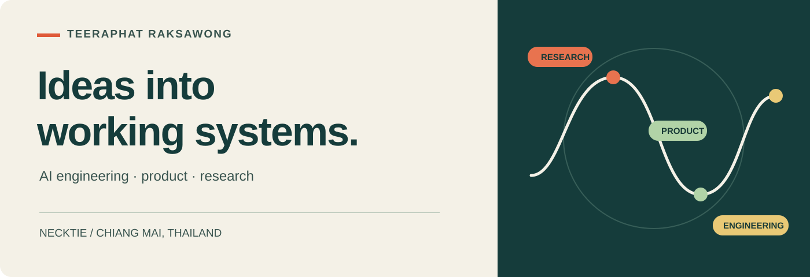

# Hi, I’m Teeraphat. You can call me Necktie.

**AI engineer and product builder · Chiang Mai, Thailand**

I like the space between an idea and a working product: understanding the business problem, designing the experience and architecture, then building and testing the system. My work spans AI agents, document intelligence, automation and software products, with research and reverse engineering when the problem calls for it.

[Portfolio](https://teeraphat-raksawong.netlify.app/) &nbsp; / &nbsp; [LinkedIn](https://www.linkedin.com/in/teeraphat-raksawong-251514179/) &nbsp; / &nbsp; [Download CV](https://teeraphat-raksawong.netlify.app/files/Teeraphat-Raksawong-CV-2026.pdf)

## What I work on

**AI systems people can inspect.** Parsing, OCR, structured extraction, retrieval and human review. I care about the path from a source to an answer, and what happens when someone needs to correct it. [Read the engineering article →](https://www.linkedin.com/pulse/building-extraction-pipeline-you-can-inspect-teeraphat-raksawong-p7mnc/)

**Products from problem to delivery.** I connect user needs and operational constraints to product decisions, UX, system design, implementation and iteration. My background in Media Arts and Design informs how I think about the people using the software.

**Agents, automation and investigation.** I build workflows around evidence, review and verification, use AI coding agents in development, and investigate unfamiliar systems to understand how they work.

## Selected work

### [nzs-skills](https://github.com/neckttiie090520/nzs-skills) · Agent workflows & human review
A collection of agent skills for routing work, gathering evidence, review and verification. Its human-review workflow records decisions and corrections against a revision; the skill is guidance for an agent, rather than an access-control system. [Read the story →](https://www.linkedin.com/pulse/agents-done-needs-witness-teeraphat-raksawong-re3yc/)

### [Google Maps RPC Scraper](https://github.com/neckttiie090520/Google-map-RPC-scraper) · Data collection
A Python and Flask application for collecting structured place and review data, with progress tracking and JSON/CSV export. [Read the story →](https://www.linkedin.com/pulse/scraper-only-beginning-teeraphat-raksawong-eohwc/)

### [ClutchG PC Optimizer](https://github.com/neckttiie090520/clutchg-pc-optimizer) · Systems & product
A Windows optimization project bringing research, a Python interface and safety decisions together. [Read the story →](https://www.linkedin.com/pulse/clutchg-what-optimize-button-should-allowed-do-teeraphat-raksawong-mlz8c/)

### More to explore

- [MCP Thai Thesis](https://github.com/neckttiie090520/mcp-thai-thesis): tools and skills for checking Thai academic documents. [Story](https://www.linkedin.com/pulse/write-thesis-yourself-automate-checks-teeraphat-raksawong-ysgxc/)
- [Perch Agent MCP](https://github.com/neckttiie090520/perch-agent-mcp): an MCP interface for delegating work through the Perch CLI. [Story](https://www.linkedin.com/pulse/give-agent-delegation-real-job-lifecycle-teeraphat-raksawong-hkmsc/)
- [Tracco Tracker](https://github.com/neckttiie090520/tracco-tracker): a workshop management app for enrollment, tasks, submissions and dashboards.

## Thinking in public

- [Designing information people can review](https://www.linkedin.com/pulse/from-narrative-evidence-designing-information-people-can-raksawong-ncjoc/): a fictional design exercise about claims, uncertain dates, evidence links and corrections.
- [Giving an invisible force a voice](https://www.linkedin.com/pulse/i-gave-invisible-force-voice-building-interactive-ai-raksawong-ila6c/): an undergraduate interactive art project exploring physical conversation with AI.

The document intelligence article describes professional work; the repositories above are separate public projects.

[Explore all repositories →](https://github.com/neckttiie090520?tab=repositories) &nbsp; · &nbsp; [Visit my portfolio →](https://teeraphat-raksawong.netlify.app/)
